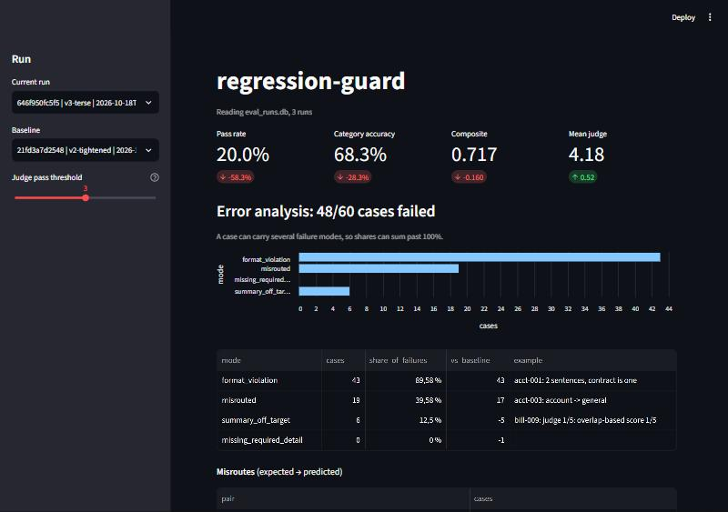

# regression-guard

CI for the behaviour of an LLM feature. It runs a hand-labelled golden dataset against a
versioned prompt on every PR, diffs the result against the last accepted run, and blocks the
merge when quality drops. Regressions land as a PR comment, a Slack alert, and an HTML diff
showing the old and new output side by side. Every run also gets an error analysis: failed cases
bucketed into named failure modes and ranked, so the report says what to fix next, not just how
much got worse.

The feature under test is a support-email triage function (category + one-sentence summary).
It is deliberately small — the subject of this repo is the machinery around it.

---

## Getting set up

```bash
pip install -e ".[dev]"
```

Then run the whole story end to end. No API key needed:

```bash
python scripts/demo.py
```

That runs three prompt versions in sequence: a baseline, an improvement that merges clean, and
a token-saving "cleanup" that quietly breaks triage and exits `2`. Open `runs/reports/index.html`
afterwards for the diff.

What the demo prints, and what it means:

| Prompt | Pass rate | Verdict | Largest failure bucket |
|---|---:|---|---|
| `v1-baseline` | 71.7% | PASS (first run) | `summary_off_target` 11, `misrouted` 7 |
| `v2-tightened` | 78.3% | PASS | `summary_off_target` 11 (+0), `misrouted` 2 (-5) |
| `v3-terse` | 20.0% | CRITICAL, exit `2` | `format_violation` 43 (+43), `misrouted` 19 (+17) |

The v2 row is the point of error analysis. The tie-break rules fixed five misroutes and nothing
else; summaries are now 85% of what is left. The next change worth making is to the summary
instructions, not to more category rules.

To see slow-drift detection, which is separate from per-run diffing:

```bash
python scripts/demo.py --drift
```

### Running against the real API

```bash
cp .env.example .env          # add OPENAI_API_KEY
export RG_PROVIDER=openai
rg run --prompt latest
```

Everything defaults to the offline `mock` provider. See
[Why there is a mock provider](#why-there-is-a-mock-provider) below — it is a design decision,
not a placeholder.

---

## Commands

| Command | What it does |
|---|---|
| `rg run` | Evaluate a prompt, diff against baseline, write the report, alert |
| `rg history` | List recent runs with pass rate and composite score |
| `rg analyze` | Re-bucket a stored run's failures into failure modes, with deltas against a baseline. No tokens spent |
| `rg validate` | Check the dataset and prompt files without calling any model |

Useful flags on `rg run`:

```
--prompt v2-tightened     version id, file path, or "latest"
--baseline <run_id>       diff against a specific run instead of the automatic pick
--provider openai|mock
--fail-on-warn            exit non-zero on WARN as well as CRITICAL
--markdown-out FILE       PR-comment-ready summary
--json-out FILE           machine-readable comparison
```

Exit codes are the contract with CI: `0` pass, `1` warn, `2` critical regression, `3` config error.

---

## How scoring works

Each case is scored on four dimensions, all stored per case:

- **Category match** — binary, and the only objective signal. Cases that a reasonable person
  could file under two headings carry `acceptable_categories`, and either is accepted.
- **Summary relevance** — an LLM judge rates the candidate summary 1–5 *against the
  hand-written reference*. Grading against a target is far more stable than grading in the
  abstract.
- **Latency** — p50 and p95 per run.
- **Token usage** — prompt and completion, per case.

A case passes when the category matches, the judge score clears the threshold (default 3), *and*
no hard deterministic assertion fails.

### Deterministic assertions

Rules that need no model run first, in `assertions.py`. They are cheap, they cannot drift, and
they cannot be talked round by fluent output.

| Check | Severity | Fails when |
|---|---|---|
| `numbers_grounded` | hard | The summary contains a number that is not in the email: an invented invoice number, date or amount |
| `single_sentence` | hard | The summary is more than one sentence, which breaks the output contract |
| `max_summary_chars` | hard | The summary is longer than 220 characters |
| `must_include` | hard | A case-specific identifier, such as an invoice number, is missing |
| `must_not_include` | hard | Case-specific forbidden content appears |
| `strict_json` | soft | The response was not bare JSON and the parser had to salvage it |
| `reference_details_kept` | soft | A number in the reference summary did not make it into the candidate |

Soft findings never change a verdict. They are counted so that a prompt slowly losing hold of
its output contract shows up before it becomes a failure.

Why they gate rather than inform: in the demo, `v3-terse` *raises* the mean judge score from
3.66 to 4.18 while 43 of its summaries are mid-word truncations spanning several sentences. The
judge grades word overlap with the reference, and truncated email text overlaps well. Only the
contract check catches it. `acct-001` regresses with a judge score of 5/5.

The **composite score** is `0.7 × category accuracy + 0.3 × normalised judge score`. Category
dominates deliberately: it is objectively checkable, the judge is not.

---

## Error analysis

A pass rate tells you how much is broken. Error analysis tells you what. `error_analysis.py`
labels every failed case with the failure modes it shows, using signals already recorded:

| Failure mode | Signal |
|---|---|
| `output_contract` | Response unparseable, unknown category, or provider error |
| `misrouted` | Wrong category, broken down by `expected -> predicted` pair |
| `hallucinated_number` | `numbers_grounded` failed |
| `forbidden_content` | `must_not_include` failed |
| `missing_required_detail` | `must_include` failed |
| `format_violation` | `single_sentence` or `max_summary_chars` failed |
| `summary_off_target` | Judge score below threshold |

Buckets are ranked by count and carry a delta against the baseline. They are multi-label, so a
misrouted case with a bad summary is counted in both buckets and shares can sum past 100%. Each
failed case also gets one *primary* mode, the most severe in the order above, for when you need
a partition. A judge call that failed is listed as infrastructure noise and never labelled
`summary_off_target`.

The analysis is printed by `rg run`, added to the PR comment and the HTML report, and included
in `--json-out` under `error_analysis`. `rg analyze --run-id <id> --baseline <id>` recomputes it
for any stored run.

The mock summariser is extractive, so it can never invent a number, and `hallucinated_number`
stays at zero offline. The check is covered by unit tests and fires against a real model.

---

## Dashboard

```bash
pip install -e ".[dashboard]"
streamlit run dashboard.py
```



It reads the same SQLite history `rg run` writes and never calls a model. It shows the headline
metrics against a chosen baseline, the failure-mode breakdown with misroute pairs, a side-by-side
table of each case's baseline and current output filtered by regressed or improved, the raw case
log filtered by failure mode, and pass-rate and failure-mode trends across runs. The judge
threshold is a slider, so you can see how many failures depend on where the line is drawn.
The data shaping is in `dashboard_data.py` and unit-tested; `dashboard.py` only lays it out.

---

## Adding cases to the golden dataset

The dataset lives in `data/golden_dataset_v1.json` and is the highest-leverage file in the repo.

Add a case:

```json
{
  "id": "bill-017",
  "email": "the raw customer email, verbatim",
  "expected_category": "billing",
  "expected_summary": "One sentence, ending in a period.",
  "expected_difficulty": "medium",
  "notes": "Why this case is in the set. Required.",
  "acceptable_categories": ["account"],
  "must_include": ["INV-4410"],
  "must_not_include": []
}
```

`must_include` is for identifiers an agent cannot act without. Use it sparingly: a case that
requires a detail the reference summary leaves out is testing the dataset author's taste.

Rules that CI enforces (`tests/test_dataset.py`):

- **Write cases by hand.** Do not generate them with a model. A dataset written by the same
  class of system being tested cannot detect that system's blind spots.
- **Every case needs `notes`** explaining why it exists. Without it, the next person maintaining
  the set deletes cases they do not understand.
- **Ambiguous cases keep their ambiguity.** If two labels are defensible, list the alternative
  in `acceptable_categories` and explain it in `notes`. Do not resolve the ambiguity by fiat —
  that trains the eval to reward a coin flip.
- At least 10 cases per category, and at least 15% marked `hard`.
- Summaries are one sentence, ≤ 220 characters.

**Grow the set from production failures, not from imagination.** The intended loop: a bad output
reaches a user → the email and correct label become a case → the eval can never regress on it
silently again. That is how the set stops reflecting what you *guessed* was hard and starts
reflecting what actually is.

Bump `dataset_version` whenever the case list changes. Comparisons across dataset versions are
still produced but are flagged in the report as mixing prompt effects with dataset effects.

---

## Adjusting thresholds

All thresholds are environment variables — see `.env.example`. The defaults:

| Variable | Default | Meaning |
|---|---|---|
| `RG_WARN_DELTA` | `0.03` | Pass-rate drop that raises a warning |
| `RG_CRITICAL_DELTA` | `0.08` | Pass-rate drop that blocks the merge outright |
| `RG_SIGNIFICANCE_ALPHA` | `0.05` | Alpha for the McNemar test |
| `RG_DRIFT_WINDOW` | `7` | Runs in the rolling drift window |
| `RG_DRIFT_FLOOR` | `0.85` | Composite score the rolling mean must stay above |

Tightening `RG_WARN_DELTA` on a small dataset mostly buys noise. If you want a stricter bar,
add cases first — a 3pp threshold on 60 cases is under two cases, which is why the significance
test exists.

---

## Architecture decisions

Full detail in [docs/ARCHITECTURE.md](docs/ARCHITECTURE.md). The four that matter most:

### 1. McNemar's exact test, not a two-proportion z-test

Both runs are scored on the *same* cases, so the two pass rates are paired. A two-proportion
test assumes independence, overstates the variance, and would wave through genuine regressions
as noise. McNemar looks only at the cases that flipped and asks whether they flipped in one
direction more than a coin flip explains. Two independent routes to CRITICAL: a drop past
`RG_CRITICAL_DELTA` on size alone, or a drop past `RG_WARN_DELTA` that is also statistically
significant.

### 2. Slow drift is tracked separately from per-run regressions

Per-run diffing is blind to a prompt that loses one case a week. Every individual run sits inside
every threshold, nothing fires, and a quarter later the feature is materially worse than anyone
signed off on. So a second detector watches the rolling mean of the composite score across the
last `RG_DRIFT_WINDOW` runs and warns on either an absolute floor breach or a consistent
downward slope.

Drift **never blocks a merge**. The commit under review is almost never the one that caused it,
and blocking an innocent PR is how a team learns to ignore the tool. It warns the team, not the
author. `python scripts/demo.py --drift` shows it firing while the per-run verdict stays PASS.

### 3. The baseline is the last run of a *different* configuration

Not simply "the previous run". If it were, re-running a failing PR would make the failing run its
own baseline, the delta would be zero, and the retry would go green — the pipeline would reward
pressing the retry button. The baseline is instead the most recent run of a different
prompt-version/model pair, so re-runs are idempotent. `--baseline <run_id>` overrides it.

### 4. Judge failures cannot fail the build

An unparseable judge response scores a neutral 3 and says so in the report. A judge that times
out is an infrastructure problem, not a quality regression, and must not be able to block a merge
on its own. Same reasoning for Slack: a delivery failure is logged and swallowed, never raised.

---

## Why there is a mock provider

An eval harness that cannot run without a funded API key is untestable in CI and unreadable to
anyone who clones it. `MockProvider` is not a stub returning a constant — it derives its behaviour
from the prompt under test. It extracts the category cue lists out of the system prompt, so a
prompt that spells out what belongs in each bucket classifies well and a prompt that does not
degrades, exactly as a real model does. That is what lets the regression machinery be exercised
end to end, deterministically, at zero cost.

The mock judge's 1–5 scale is calibrated by one documented constant
(`MOCK_JUDGE_SATURATION` in `providers.py`), because extractive summaries never reach full word
overlap with abstractive references. It is a proxy, and the code says so where it matters.

The real path is `RG_PROVIDER=openai`, and it is the same code path — only `complete()` differs.

---

## CI

`.github/workflows/eval.yml` triggers on any PR touching `prompts/`, `data/`, or the eval engine.
It runs the tests, runs the eval, uploads the HTML report as an artifact, posts the scorecard as
a PR comment (updating the existing comment rather than stacking new ones), and fails the job on
exit code 2.

Two secrets, both optional: `OPENAI_API_KEY` (falls back to the mock provider so fork PRs still
get a signal) and `SLACK_WEBHOOK_URL` (skipped with a log line when absent).

Run history is cached between runs as `runs/eval_runs.db`. A cache miss means "no baseline found",
which passes unconditionally — visible in the log, and worth knowing about before you trust a
green check on a fresh branch.

---

## Docker

```bash
docker compose run --rm eval run --prompt latest
```

The image runs as a non-root user and mounts `/app/runs` as a volume. Without that volume the
baseline does not survive a restart and every run reports "no baseline".

---

## Layout

```
prompts/          versioned prompts — the artefact CI runs against
data/             the golden dataset
src/regression_guard/
  classifier.py   the feature under test
  providers.py    OpenAI + offline mock behind one protocol
  judge.py        LLM-as-judge summary scoring
  assertions.py   deterministic checks: grounding, format contract, case constraints
  error_analysis.py  failure-mode taxonomy, ranking and baseline deltas
  dashboard_data.py  pure data shaping behind the dashboard
  runner.py       async batched test runner
  compare.py      diffing, McNemar, verdict assignment
  drift.py        rolling-window slow-drift detection
  store.py        SQLite run history
  report.py       self-contained HTML diff report
  slack.py        webhook alerting
  cli.py          entry point and CI exit codes
dashboard.py      Streamlit view over run history
tests/            148 tests, 95% coverage
```

## Tests

```bash
pytest --cov --cov-report=term-missing
```

`compare.py` is at 100% and gets the most exhaustive treatment in the suite — every threshold
boundary, both routes to CRITICAL, and the McNemar values checked against hand-computed
binomials. It is the only module that can block a merge, so it is the one that has to be right.
